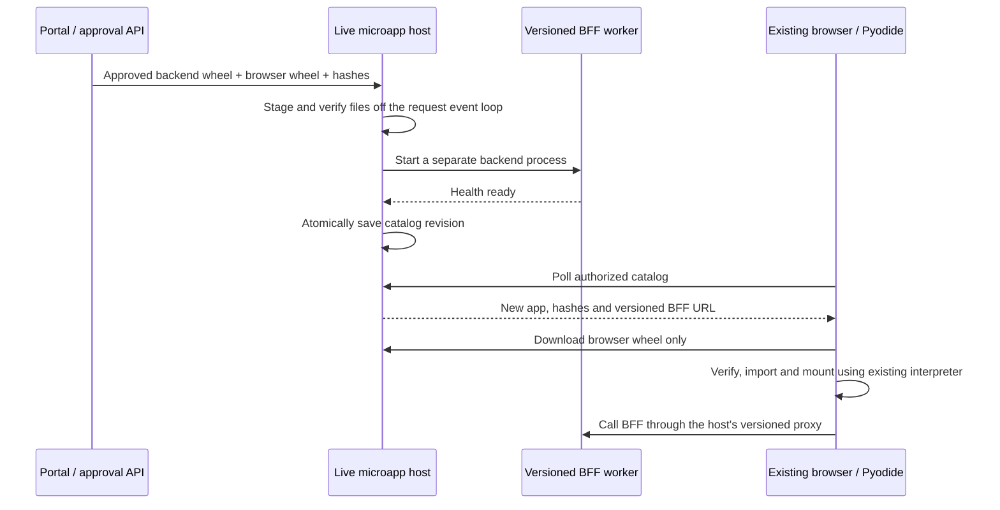

# Live microapp installation (experimental, added in 1.0.2)

For automatic S3 selection, consolidated startup bundles, and multiple ECS replicas,
see [environment bundles](environment-microapps.md), an experimental opt-in addition available in 1.0.3.
The APIs below remain available with their existing behavior.

This opt-in path adds an approved app to a running environment without rebuilding
its image, restarting its Pytincture service, reloading an open browser, or
fetching a second WASM engine. The normal `create_app()` and app-folder path do
not change. Initial bundled apps still use their existing fast startup path.
Nothing is automatically installed merely because a wheel is present.

The current implementation supports **new, uniquely namespaced pure-Python
microapps using the existing Pyodide 0.29.3 browser runtime**. It is an experimental
API, not a production marketplace or a security sandbox. It does not add
live loading to MicroPython, support arbitrary native wheels, or silently replace
already imported Python packages. Upgrading a browser app already loaded into
the shared interpreter explicitly requires a page reload in this first version.
Backend versions can coexist and the catalog can be rolled back without a restart.

## What happens during installation



A wheel is the delivery container; this does not rewrite the running Python/WASM
binary. The shared interpreter receives the new app files. There is no browser
package-index resolution or automatic `micropip` download: the browser adapter
uses Pyodide's archive extraction after checking the complete wheel hash.

## Artifact contract

The installation requires **two different, approved artifacts**:

1. A private backend wheel with the [packaged-app manifest](packaged-microapps.md).
   Its existing app directory and BFF source remain on the server.
2. A separate browser wheel containing only browser-safe Python code/resources,
   under a unique top-level namespace such as `customer_orders_ui`. Declare its
   entrypoint as `customer_orders_ui:mount`. Do not put backend source, secrets,
   or a `pytincture-app.json` backend manifest into this wheel.

Use standard Python wheel builds for each artifact. The browser wheel currently
must have no `Requires-Dist` dependencies: resolve/vendor browser dependencies into
its unique namespace at build time, or use APIs deliberately supplied by the
platform. Never install conflicting packages over the platform's initial bundle.
The server checks pure-Python wheel tags, bounded archive sizes, path traversal,
symlinks, overlapping files, and the packaged backend inventory. The browser
checks runtime compatibility, total file hash/size, and existing module names
before extracting or importing code. Hashes prove consistency with the supplied
approved digest; they are not an approval signature.

Optional backend dependency wheels must also be explicitly supplied with hashes.
No network dependency resolution runs during installation. Missing dependencies,
native platform wheels and unsupported install schemes are rejected. Each worker
has release-specific package paths plus the host's installed framework environment;
it is a separate process, not a separately secured tenant or container. The process
shares its service account, filesystem permissions and inherited environment.
Only install backend code trusted within that environment's security boundary.

## Host integration

Install the explicit server extra first; the base install does not acquire the
HTTP client used by the opt-in live host:

```sh
pip install "pytincture[microapps]==1.0.3"
```

Keep your existing base app, then explicitly wrap it:

```python
from pytincture import PytinctureConfig, create_app
from pytincture.microapps import LiveMicroappManager, create_microapp_host
from my_platform.auth import authorize_microapp  # your verified session/environment policy

config = PytinctureConfig.from_env()
manager = LiveMicroappManager("/var/lib/tenzyn/microapps", config)
app = create_microapp_host(
    create_app(config),
    manager,
    authorize=authorize_microapp,
)
```

Run `uvicorn service:app --workers 1`. The host's ASGI lifespan starts/restores the
manager and stops child workers on shutdown. A process-level file lock prevents
two controllers from opening the same store. This implementation targets POSIX
Linux/macOS; use ECS/Linux for deployment. The persistent store must be private,
writable only by the service account and preserved across controller restarts.
Staged backend source is made read-only before worker startup, including when
`require_readonly_modules_path` is enabled. Worker logs are stored under its release
directory; protect them as server logs.
The default cap is 32 retained releases, configurable up to 256; old versions count
toward the cap. There is no automatic worker GC or crash-restart supervisor yet.
Dead workers are omitted from the catalog and their BFF routes return 503; an
explicit reinstall of that approved release can restart its worker.

`authorize(scope, app_id)` must return `True`, or await `True`, only after verifying
the caller's platform session and environment membership. `app_id=None` means
catalog access. It is called again for each catalog app and for every artifact/BFF
request. Base-app middleware has not run at that point: do not assume a populated
`scope['session']`, trust a client-supplied environment id, or use `lambda: True`
in production. Integrate your platform's real authentication verifier.

The API routes are beneath `/_microapps` (configurable as one path segment):

- `GET /_microapps/catalog`: filtered environment app catalog, `private, no-store`.
- `GET /_microapps/releases/{app_id}/{release_id}/browser/{wheel}`: only the
  approved browser wheel, with the same environment authorization.
- `/_microapps/releases/{app_id}/{release_id}/backend/{application}/classcall/...`:
  BFF-only proxy into that release's private loopback worker. It forwards cookies,
  CSRF and original client/scheme information; backend authentication and BFF
  policies remain active. Private worker access also requires an internal token.

### Install from the portal's trusted control plane

There is intentionally **no public upload or install HTTP endpoint**. After your
portal validates approval and environment permissions, download the exact approved
artifacts using its AWS role and call this Python API on the controller's event loop:

```python
from pytincture.microapps import WheelArtifact, BrowserArtifact

release = await manager.install(
    "customer-orders",
    WheelArtifact("/staging/customer_orders_backend-0.3.0-py3-none-any.whl", approved_backend_sha256),
    BrowserArtifact(
        WheelArtifact("/staging/customer_orders_ui-0.3.0-py3-none-any.whl", approved_browser_sha256),
        entrypoint="customer_orders_ui:mount",
    ),
    approval_id=approved_record_id,
    # dependencies=(WheelArtifact(..., approved_dependency_sha256),),
)
```

The `approval_id` is an audit reference, not authorization by itself. Obtain hashes
and artifact locations from your authenticated review record, not from arbitrary
browser request parameters. The platform still owns review, promotion, entitlement,
S3 access and any protected management API that invokes this method.

Only a ready worker advances the catalog. Failed staging/readiness leaves the
active selection unchanged. Old release routes stay available for old tabs.
To select an installed previous version:

```python
await manager.activate("customer-orders", previous_release_id)
```

The worker health check proves service startup; validate business behavior in your
review pipeline. Activation is not a substitute for testing the app's operations.

## Browser integration with the existing fast bundle

`runTinctureApp()` still returns its existing Pyodide runtime. Pass it to the
opt-in browser client after the base application starts. The built runtime exposes the asynchronous factory
`window.createPytinctureMicroappClient(options)`; the source module also exports `MicroappClient`.

```javascript
const runtime = await runTinctureApp(yourExistingStartupConfig);
const microapps = await window.createPytinctureMicroappClient({
    runtime,
    catalogUrl: '/_microapps/catalog',
    pollMs: 15000,
    onCatalog: catalog => updateAppMenu(catalog.apps),
    onError: error => showInstallError(error),
    // If not using Pytincture's configured CSRF cookie, provide your own reader:
    // csrfToken: () => readPlatformCsrfToken(),
    // bundledApps: {'customer-orders': exactReleaseIdAlreadyInInitialBundle},
});
await microapps.start();

// When the user opens a newly listed app:
await microapps.mount('customer-orders', document.getElementById('app-content'));
// When closing it:
await microapps.unmount('customer-orders');
// On platform shutdown:
microapps.stop();
```

Polling and tab focus refresh discover additions. Discovery updates the menu;
opening an app triggers its verified download/import. `install(id)` can explicitly
prefetch it. If `bundledApps` identifies the exact same release already present,
the client skips downloading and reinstalling it. A changed runtime or conflicting
namespace causes an explicit error; the existing platform remains running.

A browser entrypoint can be plain Python using the JS context:

```python
async def mount(context):
    value = await context.callBff("services.py", "Data", "read")
    context.root.textContent = f"Live value: {value}"

# Optional; release UI resources, event handlers and tasks here.
async def unmount(context):
    pass
```

`context.callBff(module, class_name, method, args=[], kwargs={})` currently supports
JSON POST calls to that exact release. Existing generated proxies are not silently
rewritten; adapt the microapp to this context API for live calls. Streaming and
arbitrary HTTP methods need a later context extension. `context.addCleanup(fn)`
registers teardown callbacks; normal Pyodide `create_proxy`/destroy rules still
apply to other callbacks retained by DOM/widget APIs. Unmounting clears the host
container and runs cleanup, but does not pretend to unload Python modules safely.
Shared-runtime apps are trusted participants, not isolated from the platform DOM.

## ECS/S3 topology without environment redeployment

Keep the base image and initial browser bundle built per environment as today.
An app addition does not rebuild either one. The controller stages the separate
approved wheel files in its durable store and starts the new BFF process live.
S3 is artifact storage; the browser downloads its approved wheel through the
existing same-origin host. **CloudFront is not required.**

For a single ECS task, run the optional controller/host once with a durable volume.
For multiple platform ECS tasks, route `/_microapps/*` consistently to a dedicated
single-owner microapp host/service through your existing ingress. The portal must
invoke that controller, not a random replica. Do not launch independent catalogs
on every task, assume a shared S3 folder provides worker coordination, or run this
with multiple Uvicorn workers. Distributed leases, replica reconciliation,
per-app containers, failover and independent autoscaling remain future work.
Use shared authentication/revocation storage where your deployment requires it;
all base/worker instances must have compatible session configuration. When any
Pytincture login method is enabled, an explicit shared `session_secret` is required
so a platform login is verifiable in each worker. Backend BFF CSRF checks remain
active after the proxy hop.

Deploy the host capability once. Subsequent supported pure-Python app additions
use the live API without image rebuild/redeployment. Apps requiring new native or
incompatible runtime dependencies need a separately prepared deployment/runtime;
this first installer rejects them rather than mutating the platform environment.
This long-running process model is intended for ECS/services, not Lambda workers.
Existing Lambda startup/packaged-app paths remain available unchanged.

## Run the acceptance test

```sh
uv run --frozen --extra dev python -m pytest -q tests/test_live_microapps.py
cd pytincture/frontend
npx playwright test --config playwright.microapps.config.mjs
```

The browser acceptance test uses real vendored Pyodide and real BFF subprocesses.
It opens the platform **before** installation, activates an app, observes the menu
update, mounts the UI and gets `42` from its BFF. It asserts no page navigation,
no second WASM download, and preservation of the original interpreter's state.
The loopback fixture's `/test-only-install` endpoint is test-only and is never
part of the library host. For manual inspection run
`.venv/bin/python tests/live_microapp_server.py`, open `http://127.0.0.1:41839`,
then POST to that loopback fixture endpoint from another terminal.
