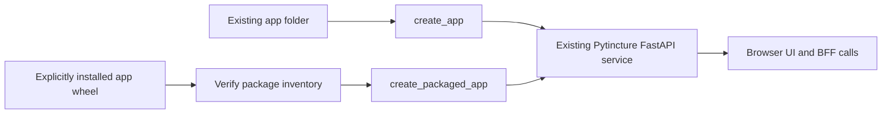

# Packaged microapps and environment delivery

## Status and compatibility

Packaged microapps are an **opt-in foundation**. Existing app folders,
`create_app()`, launch commands, legacy Pyodide delivery, normal FastAPI and
Lambda deployments continue using their current paths. Installing a wheel does
not automatically enable its app or change delivery modes.

Implemented here:

- build an app resource inventory before building a normal Python wheel;
- discover one explicitly selected installed distribution without importing it;
- check the selected version, framework compatibility and SHA-256 file inventory;
- create the existing FastAPI service with that package's app root and optional
  prebuilt BFF manifest. Deployment authentication and policy stay in configuration.

Not implemented here: an app marketplace, approval API, S3 downloader, environment
catalog endpoint, browser hot installation/replacement, versioned BFF routing,
or simultaneous incompatible backend versions. This guide describes those as
platform integration and future work, not current Pytincture functionality.
The package loader is experimental and has not been released on PyPI yet.

## Current and additional paths



A wheel is the release container, not a promise that Python has been compiled
into WASM. Build the browser bundle separately with the existing builder; include
its output and required runtime assets as package data. The backend Python and
BFF metadata remain server-side. A browser bundle and its backend belong to one
release, even when delivered through different paths.

## Build a versioned app wheel

Use a dedicated resource directory inside an ordinary Python package:

```text
customer-orders/
  pyproject.toml
  src/customer_orders/
    __init__.py
    apps/
      orders.py
      services.py
      browser/orders/…       # optional existing portable browser bundle
      bff.json               # optional prebuilt BFF parse cache
      pytincture-app.json    # generated last, before wheel build
```

`orders.py` and `services.py` are your existing application and decorated BFF
modules. Nothing in this format makes arbitrary backend files public. Existing
browser packaging and public-asset allowlists still apply.

Minimal `pyproject.toml`:

```toml
[build-system]
requires = ["setuptools>=84", "wheel"]
build-backend = "setuptools.build_meta"

[project]
name = "customer-orders"
version = "0.3.0"
dependencies = ["pytincture>=1.0.1,<2"]

[tool.setuptools.packages.find]
where = ["src"]

[tool.setuptools.package-data]
customer_orders = ["apps/*", "apps/**/*"]
```

Use a development checkout containing this feature until a supporting framework
release is published; the example dependency range alone does not add these APIs
to older releases. Declare actual app dependencies normally, and lock the entire
deployment's resolved versions and artifact hashes. Do not nest dependency wheels
inside another wheel and expect pip to install them automatically.

Build browser assets first if using portable delivery; follow
[browser-runtimes.md](browser-runtimes.md) for the explicit builder configuration.
Then build backend metadata and the final inventory:

```sh
pytincture-build-bff-manifest \
  --modules-path src/customer_orders/apps \
  --output src/customer_orders/apps/bff.json
python -m pytincture.packaged_apps \
  --modules-path src/customer_orders/apps \
  --application orders \
  --bff-manifest bff.json
python -m build
```

The BFF cache is optional. Omit `--bff-manifest` to use normal discovery. Its
format is tied to the framework parser and Python version; build it using the
same framework/Python as the target runtime. See [AWS Lambda](aws-lambda.md).
The inventory command is also installed as `pytincture-build-app-manifest`.
Rebuild it after any source, asset or BFF change. It rejects symlinks and records
all files in the dedicated app directory except generated Python bytecode and
its own manifest. Keep build outputs, secrets and unrelated files outside it.

The generated schema-1 document contains `application`, `requires_pytincture`,
optional `bff_manifest`, and relative `files` mapped to SHA-256 digests. The wheel's
standard distribution metadata owns its name, version and Python dependencies.
The loader requires exactly one `pytincture-app.json` in the selected distribution;
use one distribution per packaged service/app for this initial implementation.

## Run an installed package

Install the approved wheel and locked dependencies during image build or
provisioning. Then create `service.py`:

```python
from pytincture import PytinctureConfig
from pytincture.packaged_apps import create_packaged_app

app = create_packaged_app(
    "customer-orders",
    PytinctureConfig(
        allowed_hosts=("orders.example.com",),
        canonical_origin="https://orders.example.com",
        # Keep your existing authentication, storage and deployment settings.
    ),
    expected_version="0.3.0",
)
```

Run `uvicorn service:app`. The selected app directory becomes `modules_path`,
`orders` becomes the default application, and the packaged BFF cache is selected
if declared. All other settings come from deployment configuration. Passing no
config reads `PytinctureConfig.from_env()` as usual. Manifests cannot enable login
methods, change credentials or override host/security settings.

The installed distribution must have a normal file inventory (wheel/RECORD),
not an editable install. The loader verifies the inventoried app files and rejects
uninventoried distribution files in its app directory. Deploy to an immutable,
read-only filesystem; do not let customers write into site-packages. These hashes
check consistency, not publisher identity. Your platform must authenticate the
wheel and approve its exact digest before installation. Installing backend Python
executes customer code later; isolate customer environments accordingly.

## AWS S3 and CloudFront integration

The platform, not Pytincture startup, downloads and installs approved packages.
A possible layout is:

```text
s3://PRIVATE-ARTIFACT-BUCKET/
  candidates/customer-orders/0.3.0/<wheel-sha256>/customer_orders-0.3.0-py3-none-any.whl
  approved/customer-orders/0.3.0/<wheel-sha256>/customer_orders-0.3.0-py3-none-any.whl
  environments/dev-123/manifest.json

s3://PRIVATE-BROWSER-BUCKET/
  environments/dev-123/apps/customer-orders/0.3.0/<bundle-id>/...
```

Use separate buckets, or rigorously separate prefixes and CloudFront access, for
backend wheels and public/browser artifacts. A wheel includes backend code:
**never publish the whole wheel through your browser asset behavior**. Extract
only the builder's explicit browser artifact inventory. Do not copy the entire
`apps` directory. Publish runtime assets at their required relative locations,
including correct `application/wasm` content types.

An environment manifest is a platform-owned proposal, not a Pytincture API yet:

```json
{
  "schema": 1,
  "environment": "dev-123",
  "revision": 17,
  "apps": [{
    "distribution": "customer-orders",
    "version": "0.3.0",
    "wheel_key": "approved/customer-orders/0.3.0/<wheel-sha256>/customer_orders-0.3.0-py3-none-any.whl",
    "wheel_sha256": "<64 hexadecimal characters>",
    "browser_base_url": "https://assets.example.com/environments/dev-123/apps/customer-orders/0.3.0/<bundle-id>/",
    "approval_id": "review-456"
  }]
}
```

The environment identifier is not authorization. Its execution role should only
read its selected manifest and permitted artifacts. A separate publishing role
writes candidates; a promotion role can publish approved releases and change
environment selections. Verify the downloaded wheel's hash against an
independently trusted approved record, resolve dependencies from a locked source,
and install before starting the service. Do not install packages on each Lambda
cold start or allow browser requests to select arbitrary wheel URLs.

For browser delivery, use a private regular S3 bucket, Block Public Access, and
CloudFront Origin Access Control (OAC). Restrict the bucket policy to the specific
CloudFront distribution and browser prefix. OAC protects the S3 origin; it does
not authorize viewers. For private apps, the portal must separately authorize
users and issue appropriately scoped CloudFront signed URLs/cookies. Custom-policy
signed cookies can cover the multiple files in one app/environment prefix.

Prefer a same-origin CloudFront route for assets to simplify cookies and browser
policy. Cross-origin delivery additionally needs matching CORS, credential mode,
CSP allowances and, where the chosen runtime needs it, cross-origin isolation
headers. The current Pytincture browser loader is not extended here for arbitrary
remote manifests; a CDN base URL and its trust/credential policy need a later
loader integration. Uploading bundles to S3 alone does not activate that feature.

Cache content-addressed release assets with long immutable caching. Keep the
mutable environment selection private and uncached or revalidated. Upload all
release files first, validate backend readiness, then atomically update the single
environment manifest object. Serialize competing publishers with revision checks;
S3 is not a multi-object deployment transaction. Retain previous wheels, manifests
and browser assets for rollback and open browser sessions.

### Dev, approval and upgrades

1. Atlas builds a candidate wheel and browser artifacts with one release identity.
2. Dev environments may install their own unapproved candidates in isolation.
3. Publishing submits the exact wheel/bundle digests for automated and human review.
4. Approval promotes those unchanged artifacts; any modification requires review again.
5. Provisioning installs the selected wheel and locked dependencies into a new
   backend image/deployment; point the service at that distribution/version.
6. Switch the environment only after backend readiness. Browser live discovery,
   installation and state-preserving replacement require the later lifecycle API.

For the first implementation, upgrading means replacing/restarting the backend
and reloading its browser application. Seamless live upgrades require explicit
versioned BFF routing and old/new backend overlap; they are not provided by simply
refreshing an S3 manifest. A worker has no direct DOM access, so a future isolated
UI needs either a rendering bridge or an iframe-based contract.

## Validation and rollout

Test both the original folder service and the packaged service. Build and install
the actual wheel in a clean environment; check its manifest, browser UI, login and
real BFF calls. Test missing files, changed hashes, wrong versions, permissions,
rollback, and the existing Lambda recipe before production rollout. No AWS
resources are provisioned by this feature and the AWS architecture here has not
been deployed as part of these changes.

AWS references:

- [Restrict S3 origin access with OAC](https://docs.aws.amazon.com/AmazonCloudFront/latest/DeveloperGuide/private-content-restricting-access-to-s3.html)
- [CloudFront signed cookies](https://docs.aws.amazon.com/AmazonCloudFront/latest/DeveloperGuide/private-content-signed-cookies.html)
